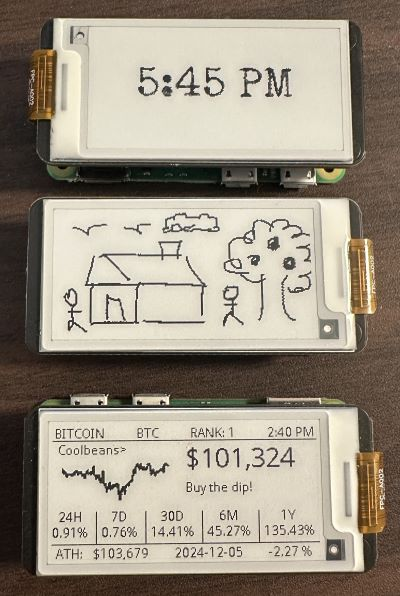
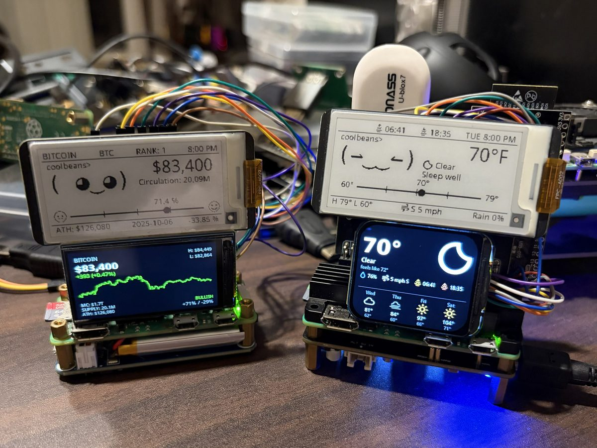
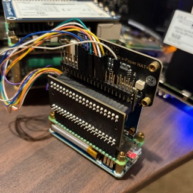

# PiE-ink

A Raspberry Pi desk pet that keeps me posted and comments throughout the day. Inspired by pwnagotchi.

<p>
  
  
  
</p>

Display the time, weather, message, sketch, book, camera feed, coin and
share prices or the system stats on an e-ink display. The web page shows exactly what's
on the panel, previews your changes before you send them, and works from any
phone or laptop on your network.

Works with Waveshare **2.13"** (V3/V4), **2.7"** (V1/V2, with four keys)
and **3.7"** e-Paper HATs, the PiSugar **Whisplay** HAT (a colour LCD
with a speaker, microphones, a button and an LED), and the RetroFlag **GPi
Case 2W** (a Pi Zero 2 W handheld: its screen, buttons and speaker). Every
screen has a layout for each size.

## Parts

- A Raspberry Pi (Zero 2 W through Pi 5) and a [micro SD card](https://amzn.to/4hEMYF4)
- [2.13" e-Paper HAT](https://amzn.to/4zeRSzU) (V3 or V4) | 2.7" e-Paper HAT (V2 recommended) | 3.7" e-Paper HAT,
- [Waveshare 1.69"](https://amzn.to/4ALyVWV) or [1.9" LCD](https://amzn.to/4AIERA3) (as a second, or by itself)
- [GPIO extender](https://amzn.to/3VeFst4)
- [GPIO splitter](https://amzn.to/3TdY9MU)
- Or instead: a PiSugar Whisplay HAT, or a RetroFlag GPi Case 2W (with a Pi Zero 2 W in it)

Optional:
- [UPS HAT](https://amzn.to/4yvY6LE)
- [Waveshare USB Hat](https://amzn.to/4j0LMye)
- Pi camera or USB webcam
- USB speaker
- USB microphone

(Amazon affiliate links)

[How it all connects](docs/schematic.png) — one page: the header pin by
pin, the HAT, the LCD's eight wires, power and USB.

## Install

1. Flash Raspberry Pi OS (Bookworm or newer, Lite is fine) and boot with the
   HAT attached.
2. On the Pi:

   ```bash
   sudo apt install -y git
   git clone https://github.com/frogCaller/piE-ink.git
   cd piE-ink
   ./setup.sh
   ```

3. Open `http://<pi-address>:5000` on your phone. The address is printed at
   the end of `setup.sh`; `http://<hostname>.local:5000` usually works too.

`setup.sh` asks one thing — your screen: an e-ink display (which one), an
LCD by itself (the 1.69", the 1.9" or a Whisplay HAT), an e-ink with a 1.69"
or 1.9" LCD beside it, or a GPi Case 2W — and sets up only what that screen
needs (`./setup.sh --screen=27v2 --lcd=1.9` answers it without asking; run
it again to change it). Then it installs the packages,
enables SPI, installs the voice and the listener (`--no-speech` skips those,
about 200 MB), and installs PiE-ink as a service that is running when it
finishes. Everything else — the bot's Ollama, Telegram, Home Assistant, your
coins and miners — is set up on the page, under the gear. It doesn't start at
boot unless you ask:

```bash
sudo systemctl enable pie-ink     # start at every boot from now on
./setup.sh --autostart            # same, during install
sudo systemctl stop pie-ink       # stop (puts the panel to sleep)
```

Swapping screens later: power off, swap, boot, and pick it under
**Settings → Screen** (or run `./setup.sh` again). A Whisplay HAT also gets
its sound card's driver from `setup.sh`, and a Whisplay that turns up on a Pi
still on the default panel is used without being picked.

In a **GPi Case 2W**, pick it when `setup.sh` asks (or run
`./setup.sh --screen=gpi`), then reboot. The case's screen is the panel, each
screen has buttons of its own (shown along the bottom), L R change screens,
the speaker talks and the power switch shuts the Pi down safely. More in [the guide](docs/guide.md#in-a-gpi-case-2w).

**Updating:** `cd piE-ink && git pull && sudo systemctl restart pie-ink`.
Your settings and files live in `config.yaml` and `data/`, which updates
never touch. **Settings → Pi → Update** runs the Pi's own updates from the
page.

## The page

Pick a tab, adjust, press the button. The preview follows as you change
things; the panel updates when you send. Under the panel, a row of tiles says
what's going on right now; the gear opens the settings; the bar along the
bottom talks to the bot. On a wide screen it's a dashboard — the tabs down
the left, the panel and the tiles across the top, the bot's conversation in
a column on the right.

## Screens

- **Clock** — big, in any font; seconds and the date if you like.
- **Weather** — today, with a face that reacts to the sky, and four days
  ahead. It finds its own location (the Pi's internet address); type a
  town if you want somewhere else.
- **Me** — your day: how far into the work block, how long awake, the
  weather, your coin or share, days to your birthday, with a face that comments.
- **Message** — your own text, or a joke, fortune or topic that changes on
  its own; read out loud if you like.
- **The bot** — your own LLM (Ollama, on the Pi or another machine) on the
  screen, with a face that follows the tone of its answer. It knows the
  time, the weather, your coins and shares and what the camera sees; it speaks through
  a speaker, listens for a wake phrase, and pipes up by itself now and then.
- **Earnings** — what today has earned so far, from your yearly figure and
  your schedule.
- **Music** — plays `data/music` through a USB speaker, or through the phone
  you're holding (**Play on this device**).
- **Draw** — pen, shapes, fill, text, photos, undo; dithered to the panel.
  With a second LCD, both canvases sit side by side.
- **Read** — EPUB, TXT and PDF books, CBZ and PDF comics, Project Gutenberg,
  xkcd and the Internet Archive's comics; turn pages from the page or the
  HAT's keys.
- **Camera** — a live view on the page, a frame a second on the panel,
  photos with filters, the other PiE-inks' cameras too.
- **Finance** — the Cryptogotchi, with shares beside the coins: CoinGecko's
  prices for the coins, Yahoo's for Apple, Tesla or an ETF (a few minutes
  behind, no key), each with a face that reacts to the market, a graph,
  ranges and headlines; your miners (Duino-Coin, Verus) and what you hold —
  with a word from the bot when it passes your line or a day goes badly.
- **System** — CPU, temperature, memory, disk, IP, uptime.
- **Group chat** — messages and postcards between the PiE-inks on your
  network and friends' Pis, and a friend's bot talking to yours.

Under the panel: **Rotate**, **Refresh** (clears ghosting) and **Off**.
**Settings → Cycle** runs a slideshow of the screens you tick.

## What else it does

- **Talks and listens.** A USB speaker gives it a voice
  ([Piper](https://github.com/rhasspy/piper), offline, a voice bundled) — or,
  with no speaker here, a Pietato on the network says its lines; a
  USB microphone lets you say "hey cool beans, what's the weather?" — or any
  phrase you set — recognised on the Pi itself. Settings → Sound.
- **Works the house.** With Home Assistant: "turn on the living room tv",
  "channel 5452", "volume up", "open netflix", "turn off the lamp" — or just
  "it's dark in here" — said, typed or sent from Telegram. Or with your hands
  in front of the camera: twist for the volume, a fist for the arrows, both
  hands open for the lights. Settings → Home.
- **Messages your phone.** A Telegram bot of your own (Settings → Telegram):
  it tells you what the camera saw, when the miners drop out or your holdings
  pass the line, and takes commands — `/screen weather`, `/photo`, `/tv`,
  `/holdings`, `/look left`, or just words.
- **Watches the room.** The camera is compared frame to frame and, when
  something changes, a vision model (or OpenCV on the Pi) says what it sees:
  a list of the day's events, a word out loud, a picture to your phone. A
  camera that turns is steered by dragging the live view (or with a game
  controller plugged into the computer you're on), the wheel or a pinch
  zooms, and it has *look around*, *follow me*, and a **little friend**
  that looks about the room by itself and says hello. Ask it "are you
  happy?" and it nods — or shakes its head — before it answers.
- **Remembers, and reminds you.** "Remember that the bins go out on
  Tuesday" goes in its notebook and into every answer from then on; "remind
  me in 20 minutes to check the oven", "wake me at 7", "set a timer for 10
  minutes" come round on the panel, out loud and on your phone.
- **Keeps watch for you.** The **agent** (Settings → Agent) reads goals in
  your own words — *tell me if the server goes down, keep an eye on the
  printer* — checks every few minutes, and acts only in the ways you tick.
- **One bot, a bigger house.** Another PiE-ink of yours on the network is
  another room of the same bot's house, not a second bot: it knows what's on
  in each room and what was said there, keeps one notebook and one list of
  reminders across them ("forget …" reaches every room), and is pleased when
  a room joins. Message a room, send it a postcard, see its camera, ask
  "which pi has a camera". Friends' Pis added by address are other houses,
  with bots of their own to set talking. What one Pi has fetched — the
  weather, coin and share prices — it shares (`/api/shared`, with how old each
  is), so another doesn't fetch it again.
- **Loves a Pietato.** [Pietato](https://github.com/frogCaller/Pietato) — the
  pocket media center — and PiE-ink share what they fetch (the weather, coin
  prices and charts: whichever is due first fetches, the other uses it), and
  PiE-ink knows one the moment it's on the network: a hello on the bot's screen (starry-eyed, out
  loud, in its own words with a model), a tile on the page, and from then on
  it knows what you're playing or watching on it, "is my Pietato around?",
  `/pis`, and its cameras among the other cameras. It's one bot for both:
  "show me the latest photo", "find the song called blue monday", "put the
  holiday video on the pietato" look on whichever Pi has it, and talking to
  the Bot on the Pietato is talking to this one. Its screen is one more
  screen: put any screen, a drawing, a message or the time on it, full
  screen — on one Pietato or all of them. Say "I'm bored" and it suggests one
  of its games (or the TV). Nothing to set up on either side.
- **Opens what's on a USB drive.** Plug one in, into the Pi or a hub, and
  the bot looks through it: "what's on the usb drive", "show me the beach
  photo on the usb drive", "open the packing list" find it there like
  anything else. setup.sh has drives mounted as they go in, read-only, so
  you can pull one out whenever. It notices whatever you plug in, too: a
  wide-eyed face and a line ("Ooh — a hub, with a keyboard and a USB drive
  on it!"), starry-eyed for a drive, sad when something's pulled out.
  [More](docs/guide.md#usb-drives-and-whatever-you-plug-in).
- **A second screen.** Pick it under Settings → Screen (the 1.69" or the 1.9"
  Waveshare LCD): it shows any screen, drawn again for its size so it fills
  it, or the same as the e-ink. Wiring and pins are in
  the [guide](docs/guide.md#a-second-screen-a-small-colour-lcd).
- **Snake, when it's bored.** Nothing from you for a while and the LCD
  starts a game of Snake, steered by a decision model (`ollama pull tev1`)
  on your bot's machine; the moment you do something, the screen you had
  comes back. [More](docs/guide.md#snake-when-its-bored).
- **Keys on the 2.7" HAT** — each gets an action under Settings → Screen:
  previous, next, next screen, full refresh, screen off.
- **Fonts** — drop a `.ttf`, `.otf` or `.ttc` into `assets/fonts/` and it
  appears in every font dropdown within seconds.

## Running without a Pi

```bash
PIE_INK_DRIVER=mock python3 app.py      # 2.13" shape
PIE_INK_DRIVER=mock27 python3 app.py    # 2.7" shape
PIE_INK_DRIVER=mock37 python3 app.py    # 3.7" shape
```

Everything works, including the preview; it just doesn't push to a panel.
`python3 selftest.py` renders every screen at every size; `python3
smoketest.py` boots the app and pokes every route, and runs the real e-ink
drivers over a pretend bus.

## Layout

```
app.py                 web server and JSON API
setup.sh               installer (the one question, your screen; its packages, SPI or the GPi Case; USB drives; systemd service)
pie_ink/service.py     the one thread that owns the panel
pie_ink/panels/        the panels: 2.13" V3/V4, 2.7" V1/V2, 3.7", Whisplay, GPi Case 2W, mocks
pie_ink/modes/         the screens
pie_ink/               everything else: camera, sound, listening, the bot, the markets, the agent, the friend…
waveshare_epd/         Waveshare's drivers
assets/                fonts, icons, jokes, fortunes, topics, seed prices
data/                  your books, drawings, coins and shares, photos and cache (made at runtime)
```

## Troubleshooting

- Nothing on the screen: check the HAT is seated and SPI is on
  (`ls /dev/spidev*`; if not, `sudo raspi-config nonint do_spi 0` and
  reboot), then `journalctl -u pie-ink -f`. The status line under the
  preview shows the last error.
- "No answer from the panel": the driver and the HAT don't match. A 2.7" is
  V1 or V2 (the V2 says so on the board), a 2.13" V3 or V4 — pick the other
  one under Settings → Screen.
- `can not open gpiochip`: `sudo apt install python3-lgpio`, and your user in
  the `gpio` and `spi` groups (`sudo usermod -aG gpio,spi $USER`).
- Ghosting: tap **Refresh**, or lower "Full refresh every".
- A webcam, speaker or microphone that "isn't working": press **Why not
  found?** on the Camera tab, or **Speaker or mic missing?** under
  Settings → Sound. Each
  checks the USB bus, the drivers and the permissions and says which of the
  usual things it is. On a Zero 2 W it is nearly always power — use a hub
  with its own supply and a data (OTG) adapter.

The [guide](docs/guide.md#troubleshooting) has the rest.

## Credits

- Coin prices from [CoinGecko](https://www.coingecko.com/en/api); share
  prices from Yahoo Finance's chart service (unofficial, no key; delayed);
  weather from [Open-Meteo](https://open-meteo.com/) and the US National
  Weather Service.
- `waveshare_epd/` is Waveshare's e-Paper library (MIT), with two small
  changes: the wait for the controller gives up after 30 s instead of never,
  and the SPI device isn't reopened on top of itself at every init. The 2.7"
  frames are packed and sent in one transfer by `pie_ink/panels/eink.py`.
- The Whisplay HAT's pin map and panel init values come from
  [PiSugar's driver](https://github.com/PiSugar/whisplay) (Apache-2.0); the
  LCD init sequences follow Waveshare's examples. Voices are
  [Piper](https://github.com/rhasspy/piper) models; listening is
  [Vosk](https://alphacephei.com/vosk/); the bot talks to
  [Ollama](https://ollama.com/).
- Fonts: DejaVu Sans Mono (Bitstream Vera licence), Fredericka the Great,
  Rubik Doodle Shadow, Gravitas One and Gluten (SIL OFL), Special Elite
  (Apache-2.0), 04b_08 (free).
